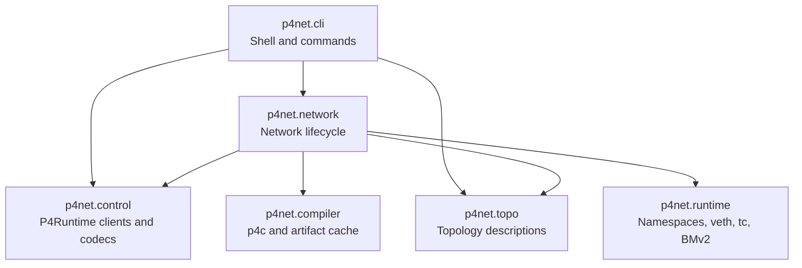

# Architecture

p4net describes a topology in Python, compiles its P4 programs with `p4c`, and runs hosts and BMv2 switches on a Linux system. Six packages separate topology data, compilation, system resources, control-plane operations, orchestration, and the CLI.

## Layered architecture

The arrows show the main calls between packages. `network` creates and releases runtime resources, then gives the CLI and user code access through running-node handles. The CLI also uses control-plane codecs to display field values. `control` communicates with the switch's P4Runtime server; it does not manage the BMv2 process. The packages also share the `P4NetError` base class from `runtime.exceptions`.

## The six packages

### `p4net.runtime`

This package provides the Linux and process operations used by the orchestrator:

- `NetworkNamespace` creates and removes namespaces through `pyroute2`. Its `exec()` and `popen()` methods run commands through `ip netns exec`.
- `VethPair` creates interfaces, moves either end into a namespace, and configures addresses, MAC, MTU, and link state through `pyroute2`.
- `apply_netem()` uses `tc qdisc replace` to set egress delay, jitter, loss, and rate. `clear_qdisc()` removes the root qdisc and accepts an already absent qdisc.
- `BMv2Switch` starts `simple_switch_grpc`, builds its arguments, and manages its log file and shutdown. `wait_until_ready()` checks that the child is alive and owns both its gRPC and Thrift listeners. A listener owned by another process is a startup error.
- `NSProcess` wraps a process started inside a namespace. It provides `pid`, `poll()`, `wait()`, `terminate()`, and `kill()`. `close()` is retained as a no-op for compatibility.
- `disable_ipv6()` and `enable_ipv6()` write per-interface sysctl settings in a host namespace or the root namespace.

These objects manage individual resources. `Network` determines their creation and cleanup order. See the [runtime API](api/runtime.md).

For non-ASCII interface names, `VethPair` creates temporary ASCII names and assigns the requested names after udev has processed the devices. When udev is active, `udevadm` must be on `PATH`; creation waits up to five seconds for its rules to finish. Waiting or naming failures remove the pair by interface index.

`VethPair(..., namespace_a=..., namespace_b=...)` places the endpoints in their target namespaces during creation; `None` selects root. Host endpoints move under temporary names and receive their requested names in the same kernel request. A failed placement removes the pair through an endpoint whose location is known.

Destroying a pair clears its current namespace positions and retains its creation targets. Recreating the same object uses the constructor's namespace settings. Moving an endpoint does not change where it will be created next time.

### `p4net.topo`

`Host`, `P4Switch`, `LinkEndpoint`, and `Link` are frozen data classes. They describe addresses, switch configuration, link endpoints, and impairments. `Topology` is a mutable builder that collects these descriptions, validates them, serializes them, and exports Graphviz diagrams. Building a description creates no network resources.

Host ports are assigned from 0, switch ports from 1. Automatic allocation skips the switch's configured CPU port, which is reserved for controller traffic. Assigning it explicitly to a link reports a `TopologyError`; `Topology.validate()` also rejects this conflict in imported topologies. Generated interface names have the form `<node>-eth<port>`. Names longer than Linux's 15-byte limit are rejected.

Port numbers must be `int` values, excluding `bool`. Host ports must be non-negative. Switch data ports range from `0` to `510`, and CPU ports from `1` to `510`. Switch port `0` remains available through explicit assignment. Automatic switch allocation uses ports `1..510`, skips the CPU port, and reports a `TopologyError` when exhausted. Invalid port values are rejected without converting strings or floats. Imported switch data ports are also checked by `Topology.validate()`.

Switch `device_id`, `grpc_port` and `thrift_port` also require `int` values, excluding `bool`. Device IDs range from `0` to `2147483647`. gRPC and Thrift ports range from `1024` to `65535`. Passing `None` to `Topology.add_switch()` selects automatic assignment. Invalid types report a `TopologyError` at construction, including when loading a topology from a dictionary.

Node names must be unique across hosts and switches. Node keys in `hosts` and `switches` must match each description's `name`, including nodes without links. `from_dict()` preserves both values, and `validate()` reports duplicate names or mismatches without changing the snapshot.

`Topology.from_dict()` restores endpoint ports as stored. If an endpoint's `port` is omitted or `None`, `Topology.validate()` reports a `TopologyError` naming the link, endpoint and node. Network startup performs this check before compilation or network resource creation. Explicit port `0` is valid.

`Topology.from_dict()` also restores interface names as stored. `Topology.validate()` rejects a missing, `None` or empty `iface_name`, identifying the link, endpoint and node. Valid custom names are preserved.

Interface names must be unique within each final namespace. Each host has its own namespace; all switches share root. Different namespaces may reuse a name, including both ends of one link, regardless of link declaration order. Validation rejects duplicates within one namespace and the reserved loopback name `lo` before compilation or resource creation.

Topology and runtime code use the same interface-name checks. Names must be UTF-8 strings of at most 15 bytes, cannot be `.` or `..`, and cannot contain whitespace, `/`, `:` or NUL. Invalid names report a `TopologyError` during topology validation or a `ValueError` when constructing a `VethPair`. For example, `界界界界界` uses 15 bytes and passes name validation; adding another `界` exceeds the limit.

Address collision checks use the same address selection as network startup. A link endpoint's `ip` or `ip6` overrides the host default for that address family. Without an override, only the host's first declared link inherits its default. Overridden defaults and defaults on hosts without links do not participate in collision checks. The topology data is preserved.

Different hosts cannot use the same effective IP address, regardless of prefix length. Different IP addresses with overlapping subnets are allowed, as is reusing an address on multiple interfaces of the same host.

IPv4 and IPv6 addresses belong to host endpoints. On P4 switch data ports, omit `ip` and `ip6` or set them to `None`. `from_dict()` preserves address fields from snapshots. `validate()` rejects addresses on switch endpoints before compilation or network resources are created.

Link impairments have three forms: symmetric values, per-direction values such as `delay_a_to_b`, and additions such as `delay_a_to_b_extra`. An addition requires a symmetric base. For example, `delay="100ms"` with `delay_a_to_b_extra="100ms"` gives 200 ms from `a` to `b` and 100 ms from `b` to `a`. A symmetric value cannot be combined with its direct per-direction override.

Construction checks field values and parameter combinations. `Topology.validate()` additionally checks endpoint references, self-links, port and device-ID collisions, switch service-port collisions, interface names, and host address conflicts. Network startup calls it unless `unsafe=True`. The CLI also validates before `topology graph`.

The builder remains mutable after startup. Editing it does not change running resources. See [topology changes](known-limitations.md#4-live-topology-mutation-not-supported) and the [topology API](api/topo.md).

### `p4net.compiler`

`P4Compiler` runs `p4c -E` before every cache lookup. The key includes the absolute source path, source bytes, preprocessed input, architecture, compiler version, and argument list. A cache hit reuses the BMv2 JSON and P4Info. On a miss, `p4c -e` compiles the same preprocessed snapshot used for the key.

The default cache is `~/.cache/p4net/compiler/`. Each `CompileResult` records the artifact paths, source hash, compiler version, and whether backend compilation was skipped. See the [compiler API](api/compiler.md).

### `p4net.control`

`P4RuntimeClient` provides synchronous connection, arbitration, pipeline installation, table operations, counters, multicast groups, and PacketIn/PacketOut. `AsyncP4RuntimeClient` uses `grpc.aio` for awaited RPC operations and async packet handling. BMv2 register operations use `simple_switch_CLI` through the configured Thrift address.

`P4InfoIndex` resolves names, IDs, match types, bit widths, and controller metadata. The codec functions encode values and format decoded matches. The formatters use IPv4 for 32-bit fields, MAC for 48-bit fields, IPv6 for 128-bit fields, and decimal for other widths.

`Network` supplies its synchronous clients with a millisecond timestamp as the high part of the election ID. A directly constructed `P4RuntimeClient` defaults to `(1, 0)`. Primary status depends on arbitration with the other clients connected to that device. See the [async client guide](async-client.md#connections-and-primary-status) for explicit election IDs.

When the synchronous StreamChannel ends or fails, the client clears its connection state and closes the channel. Call `connect()` on the same client to reconnect. Lifecycle calls wait for channel cleanup already in progress. A write or pipeline update rejected with `PERMISSION_DENIED` raises `NotPrimaryError`; the connection remains available for reads.

See the [control-plane API](api/control.md).

### `p4net.network`

`Network(topology)` owns the resources needed to run a description. The synchronous `start()` performs these steps:

1. Validate the topology unless `unsafe=True`, then allocate log and optional pcap directories.
2. Compile each switch's P4 source.
3. Register the network for process-exit cleanup. On the main thread, install SIGINT/SIGTERM handling as well.
4. Create a namespace for each host and bring up its loopback interface.
5. Create veth pairs, move host ends into their namespaces, configure IPv6 settings, addresses, MAC, MTU, and link state, then apply directional impairments.
6. Add configured IPv4 and IPv6 default routes.
7. Start each BMv2 switch and wait for that process to own its gRPC and Thrift listeners before starting the next switch.
8. Connect one synchronous P4Runtime client per switch and install its pipeline.
9. Wait for configured IPv6 addresses to finish duplicate address detection, with a five-second budget shared by all hosts. A duplicate address or an expired wait fails startup.
10. Create the `RunningHost` and `RunningSwitch` handles exposed by `host()`, `switch()`, `hosts`, and `switches`.

A failed startup rolls back the resources already created. `await net.astart()` registers cleanup on the calling thread before submitting the startup work to a worker thread. Use the main thread's event loop for automatic signal handling. Cancelling startup waits for the worker and cleanup before propagating cancellation. A concurrent shutdown waits for startup before releasing resources.

`RunningHost` exposes namespace commands and connectivity checks. `RunningSwitch` exposes the BMv2 process, compilation result, synchronous client, and a lazily created, cached async client. The async client must be connected before use.

`await net.astop()` waits for cleanup, including disconnecting cached async clients on their owning event loops. Keep those loops running until shutdown finishes. Inside an event loop, `stop()` starts background cleanup and returns. Outside an event loop, it waits for cleanup. See the [async lifecycle guide](async-client.md#shutting-down-a-network).

See the [network API](api/network.md).

### `p4net.cli`

The command entry point loads a Python file containing a `topology` object, starts its network, and calls an optional `setup(net)` function. It then starts the interactive shell or waits for a signal with `--no-shell`.

`CommandDispatcher` parses and executes commands against the running network. `P4NetShell` adds history, completion, Ctrl-C to cancel the current input, and Ctrl-D to leave the shell. The `topology graph` command exports the description as DOT or renders it with Graphviz.

See the [CLI guide](cli.md) and [CLI API](api/cli.md).

## Design principles

### BMv2 in the root namespace, hosts in private namespaces

Each host has its own network namespace. BMv2 runs in the root network namespace and attaches to the root-side veth interfaces. Switch-to-switch links keep both ends in that namespace.

The control clients reach the switch through `127.0.0.1:<grpc_port>`. The switch forwards experiment traffic through its attached interfaces. This separates the host network stacks while keeping control-plane connections local. Topology validation catches service-port collisions within a description; BMv2 startup also detects listeners owned by other processes.

### Running namespace commands { #subprocesspopenip-netns-exec--over-pyroute2nspopen }

Host commands use `subprocess.run()` or `subprocess.Popen()` with `ip netns exec <name> <argv>`. The external `ip` program enters the namespace before executing the requested command. p4net does not use `pyroute2.NSPopen` for this path or supply a Python `preexec_fn`.

This avoids running a Python namespace helper between process creation and command execution in an application that already has P4Runtime threads. Python documents the [threading restriction on `preexec_fn`](https://docs.python.org/3/library/subprocess.html#popen-constructor). Namespace creation, interface setup, and listener inspection still use `pyroute2`.

### Content-addressed compiler cache

Changes to included headers, macro expansion, or headers selected through `-I` affect the preprocessed input and therefore the cache key. A missing include fails preprocessing even if older artifacts exist. Changing only a file's timestamp can still yield a cache hit.

Preprocessing and backend compilation run outside the cache lock. Concurrent calls compile into separate staging directories. A directory lock protects the final artifact check and publication. Missing or empty JSON/P4Info artifacts cause a rebuild. `force=True` retains the previous entry until the new artifacts are ready, then replaces it under the lock and restores it if publication fails.

### Resource cleanup { #cleanup-is-first-class }

Cleanup runs when a `with Network(...)` block exits, at normal process exit, on SIGINT/SIGTERM, or through an explicit `stop()`/`astop()` call. In a running main-thread event loop, signal handling awaits `astop()` before restoring the previous handler and redelivering the signal. Outside an event loop, it uses synchronous cleanup.

The cleanup order is:

1. User processes tracked by `Network`, including terminals opened with `net.xterm()`.
2. Cached async P4Runtime clients, followed by synchronous clients.
3. BMv2 processes. `BMv2Switch.stop()` sends SIGTERM and waits 5 seconds by default before escalating to SIGKILL.
4. Veth pairs, then host namespaces.
5. Cleanup registry entries and running-node handles.

Repeated cleanup calls share the shutdown operation. Cleanup logs an error from one resource and continues with the others. After `fork()`, the child has an empty network registry and its own signal-cleanup state, so its cleanup does not stop the parent's networks. See the [fork limitation](known-limitations.md#1-grpc-connections-and-process-creation) for gRPC connections.

### IPv6 sysctl gating before interface up

Before bringing up a host interface, the orchestrator checks its resolved IPv6 address. Without one, it sets `disable_ipv6=1`. With one, it sets `disable_ipv6=0`, `accept_ra=0`, and `autoconf=0`, then configures the address and brings the interface up.

The latter settings disable router-advertisement processing and SLAAC. Link-local address generation has a separate kernel setting, `addr_gen_mode`; p4net leaves it unchanged. An IPv6-enabled interface can therefore also acquire a link-local address. See the [Linux IPv6 sysctl documentation](https://docs.kernel.org/networking/ip-sysctl.html#proc-sys-net-ipv6-variables).

### Directional link impairments { #asymmetric-impairment-via-direction-mapped-veth-side-tc-qdisc }

For a link declared with endpoints `a` and `b`, `*_a_to_b` settings apply to egress on the `a` interface. `*_b_to_a` settings apply to egress on `b`. The endpoint order determines the direction, whether the endpoint is a host or a switch.

For example, `topology.add_link(h1, s1, delay_a_to_b="200ms")` delays traffic leaving `h1`. Adding `topology.add_link(h2, s1, delay_b_to_a="20ms")` delays traffic leaving `s1` toward `h2`. Together these settings add 220 ms of configured delay to the request path from `h1` to `h2`. Measured RTT also includes forwarding, queuing, and host scheduling. See [performance measurements](performance.md).

## Data flow walk-through

The [quick-start example](examples/quick-start.md) connects two hosts to ports 1 and 2 of one switch. Its setup function installs static ARP entries. For `h1.ping(h2)` with the default count and timeout:

1. `RunningHost.ping()` runs `ping -4 -c 1 -W 2 10.0.0.2` through `ip netns exec h1`, waiting up to three seconds before interrupting the process.
2. The host kernel sends the ICMP echo request through `h1-eth0` to the peer interface `s1-eth1`.
3. BMv2 parses the Ethernet header. The P4 ingress control selects output port 2 for input port 1.
4. The frame leaves through `s1-eth2` and reaches `h2-eth0` in the second host namespace.
5. `h2` sends the echo reply along the reverse path. The P4 program maps input port 2 to output port 1.
6. The ping command receives a reply and exits with status 0. `RunningHost.ping()` returns `True`.

The port-swap program parses only Ethernet headers. IPv4, IPv6, and ARP frames use the same forwarding path. With IPv6 host addresses configured, IPv6 ping uses `-6` and the same interfaces.

## Current scope { #whats-deliberately-not-supported }

p4net currently runs local Linux experiments with `simple_switch_grpc` and the `v1model` architecture. Host isolation uses network namespaces rather than a container runtime. The control interfaces are P4Runtime and the BMv2 Thrift CLI for register operations.

The project has no built-in OpenFlow/Open vSwitch integration, hardware-switch target, distributed orchestration, or gNMI/gNOI/OpenConfig client. PSA support needs compiler and runtime integration. Live resource changes need an orchestration interface beyond editing the topology description. See [known limitations](known-limitations.md) and the [roadmap](roadmap.md).
