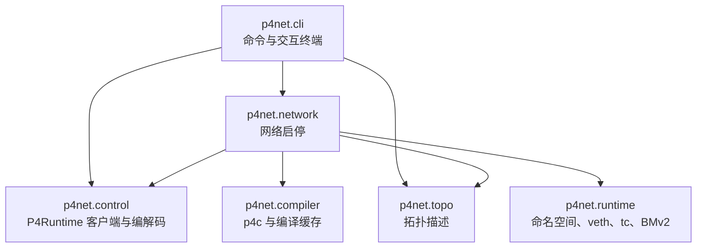

# 架构

p4net 用 Python 描述拓扑，通过 `p4c` 编译 P4 程序，在 Linux 系统中运行主机和 BMv2 交换机。六个包分别负责拓扑描述、编译、系统资源、控制面操作、网络编排和命令行交互。

## 分层架构

箭头表示包之间的主要调用关系。`network` 创建和释放运行资源，通过运行节点对象供 CLI 和用户代码访问。CLI 还使用控制面的编解码函数显示字段值。`control` 与交换机的 P4Runtime 服务通信，BMv2 进程由 `runtime` 管理。各包的异常还共用 `runtime.exceptions` 中的 `P4NetError` 基类。

## 六个包

### `p4net.runtime`

提供编排器使用的 Linux 资源和进程操作：

- `NetworkNamespace` 通过 `pyroute2` 创建和删除命名空间，`exec()` 和 `popen()` 通过 `ip netns exec` 执行命令。
- `VethPair` 通过 `pyroute2` 创建接口，将任一端移入命名空间，并配置地址、MAC、MTU 和接口状态。
- `apply_netem()` 使用 `tc qdisc replace` 配置出方向的时延、抖动、丢包和速率。`clear_qdisc()` 删除根 qdisc，未配置 qdisc 时可重复调用。
- `BMv2Switch` 启动 `simple_switch_grpc`，构造参数，管理日志文件和进程退出。`wait_until_ready()` 检查子进程仍在运行，且同时持有 gRPC 和 Thrift 监听套接字。监听套接字属于其他进程时，启动失败。
- `NSProcess` 封装命名空间内启动的进程，提供 `pid`、`poll()`、`wait()`、`terminate()` 和 `kill()`。`close()` 为兼容旧调用而保留，不执行操作。
- `disable_ipv6()` 和 `enable_ipv6()` 写入主机命名空间或 root 命名空间中的接口 sysctl 配置。

这些对象分别管理单个资源，创建和回收的顺序由 `Network` 决定。详见[运行时 API](api/runtime.md)。

### `p4net.topo`

`Host`、`P4Switch`、`LinkEndpoint` 和 `Link` 是冻结的数据类，保存地址、交换机配置、链路端点和链路参数。`Topology` 是可修改的构造器，负责汇集描述、校验、序列化和导出 Graphviz 图。构造描述不会创建网络资源。

主机端口号从 0 开始分配，交换机端口号从 1 开始。自动分配会跳过交换机配置的 CPU 端口，该端口留给控制器收发数据包。显式将它分给链路会报 `TopologyError`，从字典导入拓扑后，`Topology.validate()` 也会拒绝这类冲突。自动生成的接口名形如 `<node>-eth<port>`，超过 Linux 的 15 字符上限时会报错。

端口号必须是 `int`，不接受 `bool`。主机端口号为非负整数，交换机数据端口范围是 `0..510`，CPU 端口范围是 `1..510`。交换机端口 `0` 可显式指定。自动分配使用 `1..510`，跳过 CPU 端口，用尽后报 `TopologyError`。非法端口值直接报错，不转换字符串或浮点数。导入拓扑中的交换机数据端口也由 `Topology.validate()` 检查。

链路参数支持三种形式：对称值、`delay_a_to_b` 这样的逐方向值，以及 `delay_a_to_b_extra` 这样的附加值。附加值需要对称基础值。例如，`delay="100ms"` 加 `delay_a_to_b_extra="100ms"`，得到 `a` 到 `b` 方向 200 ms、反向 100 ms 的时延。对称值不能与同一参数的直接逐方向覆盖值混用。

描述对象在构造时检查字段值和参数组合。`Topology.validate()` 进一步检查端点引用、自环、端口和设备 ID 冲突、交换机服务端口冲突、接口名及主机地址冲突。网络启动时会调用它，除非设置了 `unsafe=True`。CLI 执行 `topology graph` 前也会校验。

网络启动后，拓扑描述仍可修改，但修改不会改变运行资源。详见[拓扑变更限制](known-limitations.md#4-不支持运行中拓扑变更)和[拓扑 API](api/topo.md)。

### `p4net.compiler`

`P4Compiler` 每次查询缓存前都会运行 `p4c -E`。缓存键包含源码绝对路径、源码字节、预处理结果、目标架构、编译器版本和参数列表。命中缓存时复用 BMv2 JSON 和 P4Info，未命中时用 `p4c -e` 编译参与缓存键计算的同一份预处理结果。

默认缓存目录是 `~/.cache/p4net/compiler/`。`CompileResult` 记录产物路径、源码哈希、编译器版本，以及是否跳过了后端编译。详见[编译器 API](api/compiler.md)。

### `p4net.control`

`P4RuntimeClient` 提供同步连接、仲裁、流水线下发、表项操作、计数器、组播组和 PacketIn/PacketOut。`AsyncP4RuntimeClient` 使用 `grpc.aio`，通过协程执行 RPC 和处理数据包。BMv2 寄存器操作则通过 `simple_switch_CLI` 访问配置的 Thrift 地址。

`P4InfoIndex` 查询名称、ID、匹配类型、位宽和控制器元数据。编解码函数负责值的编码及匹配字段的格式化。格式化时，32 位字段按 IPv4 展示，48 位按 MAC 展示，128 位按 IPv6 展示，其余位宽使用十进制。

`Network` 创建同步客户端时，用毫秒时间戳作为选举 ID 的高位。直接构造 `P4RuntimeClient` 时，默认值是 `(1, 0)`。客户端能否获得主控权，取决于与同一设备上其他客户端的仲裁结果。需要明确指定选举 ID 时，参见[连接与主控权](async-client.md#连接与主控权)。

同步客户端的 StreamChannel 结束或报错后，会清除连接状态并关闭通道。可在同一客户端上调用 `connect()` 重连。旧通道正在清理时，生命周期方法会等待清理完成。交换机以 `PERMISSION_DENIED` 拒绝写入或流水线更新时，客户端抛出 `NotPrimaryError`，连接仍可用于读取。

详见[控制面 API](api/control.md)。

### `p4net.network`

`Network(topology)` 管理运行拓扑所需的资源。同步 `start()` 按以下顺序执行：

1. 校验拓扑，除非设置了 `unsafe=True`，然后准备日志目录和可选的抓包目录。
2. 编译各交换机的 P4 源码。
3. 将网络加入进程退出清理注册表。在主线程中还会安装 SIGINT/SIGTERM 处理器。
4. 为每台主机创建命名空间，启用回环接口。
5. 创建 veth 对，将主机侧接口移入对应命名空间，配置 IPv6、地址、MAC、MTU 和接口状态，再应用各方向的链路参数。
6. 添加已配置的 IPv4 和 IPv6 默认路由。
7. 逐台启动 BMv2，确认当前进程持有 gRPC 和 Thrift 监听套接字后，再启动下一台交换机。
8. 为每台交换机连接一个同步 P4Runtime 客户端，下发流水线。
9. 等待已配置的 IPv6 地址完成重复地址检测，所有主机共用五秒等待时间。检测失败或等待超时则启动失败。
10. 创建 `RunningHost` 和 `RunningSwitch` 对象，供 `host()`、`switch()`、`hosts` 和 `switches` 访问。

启动失败时，回收已经创建的资源。`await net.astart()` 先在调用线程注册清理，再将启动工作提交到工作线程。需要自动处理退出信号时，使用主线程的事件循环。取消启动时，会等待工作线程和清理结束，再传播取消异常。启动与关闭同时发生时，关闭过程会先等待启动线程结束，再释放资源。

`RunningHost` 提供命名空间内的命令执行和连通性检查。`RunningSwitch` 提供 BMv2 进程、编译结果、同步客户端，以及延迟创建并缓存的异步客户端。异步客户端需要连接后才能使用。

`await net.astop()` 等待清理完成，包括在缓存的异步客户端所属的事件循环中关闭连接。保持这些事件循环运行，直到关闭完成。在事件循环内调用 `stop()`，会启动后台清理并返回；在事件循环之外调用，则等待清理完成。详见[异步生命周期指南](async-client.md#关闭网络)。

详见[网络 API](api/network.md)。

### `p4net.cli`

命令行入口加载包含 `topology` 对象的 Python 文件，启动网络，再调用可选的 `setup(net)` 函数。随后进入交互终端，或在 `--no-shell` 模式下等待信号。

`CommandDispatcher` 解析命令并操作运行网络。`P4NetShell` 提供历史记录和补全，Ctrl-C 取消当前输入，Ctrl-D 退出终端。`topology graph` 将拓扑描述导出为 DOT，或通过 Graphviz 渲染。

详见 [CLI 指南](cli.md)和 [CLI API](api/cli.md)。

## 设计原则

### BMv2 与主机的命名空间布局 { #bmv2-在-root-命名空间主机各自占用私有命名空间 }

每台主机使用独立的网络命名空间。BMv2 运行在 root 网络命名空间，连接 veth 在 root 命名空间中的接口。交换机之间的链路两端都留在该命名空间。

控制客户端通过 `127.0.0.1:<grpc_port>` 连接交换机，交换机通过接入的接口转发实验流量。这样既分离了各主机的网络协议栈，又保留了本机控制连接。拓扑校验检查同一描述中的服务端口冲突，BMv2 启动时还会检查监听套接字是否被其他进程占用。

### 在命名空间中执行命令 { #subprocesspopenip-netns-exec--而非-pyroute2nspopen }

主机命令通过 `subprocess.run()` 或 `subprocess.Popen()` 执行 `ip netns exec <name> <argv>`。外部程序 `ip` 先进入命名空间，再执行目标命令。p4net 在这条路径上不使用 `pyroute2.NSPopen`，也不传入 Python `preexec_fn`。

这使已经启动 P4Runtime 线程的进程，无需在创建子进程与执行目标命令之间运行 Python 命名空间辅助代码。Python 文档说明了 [`preexec_fn` 在多线程程序中的限制](https://docs.python.org/3/library/subprocess.html#popen-constructor)。命名空间创建、接口配置和监听套接字检查仍使用 `pyroute2`。

### 内容寻址的编译缓存

引用头文件、宏展开或 `-I` 路径选中的头文件发生变化时，预处理结果和缓存键也会变化。即使已有旧产物，引用文件缺失仍会导致预处理失败。仅修改文件时间戳，不修改内容，仍可命中缓存。

预处理和后端编译在缓存锁之外执行。多个调用分别在临时目录中编译，目录锁保护最终的产物检查和发布。JSON 或 P4Info 缺失、为空时会重新编译。设置 `force=True` 后，旧条目会保留到新产物准备完成，再加锁替换；发布失败时恢复旧条目。

### 资源回收 { #清理是一等公民 }

退出 `with Network(...)` 块、进程正常退出、收到 SIGINT/SIGTERM，或显式调用 `stop()` / `astop()`，都会触发清理。主线程的事件循环运行时，信号处理器先等待 `astop()`，再恢复原处理器并重新投递信号。事件循环之外使用同步清理。

回收顺序为：

1. `Network` 跟踪的用户进程，包括通过 `net.xterm()` 打开的终端。
2. 缓存的异步 P4Runtime 客户端，然后是同步客户端。
3. BMv2 进程。`BMv2Switch.stop()` 先发送 SIGTERM，默认等待 5 秒，超时后升级为 SIGKILL。
4. veth 对，然后是主机命名空间。
5. 清理注册表项和运行节点对象。

重复调用清理方法会共用关闭过程。单个资源回收报错时会记录日志，并继续处理其余资源。`fork()` 后，子进程使用空的网络注册表和独立的信号清理状态，不会因自身清理而停止父进程的网络。gRPC 连接的限制见 [fork 说明](known-limitations.md#1-grpc-连接与进程创建)。

### 接口启用前的 IPv6 配置 { #ipv6-sysctl-在拉起接口之前 }

启用主机接口前，编排器先检查该接口最终使用的 IPv6 地址。没有地址时设置 `disable_ipv6=1`；有地址时设置 `disable_ipv6=0`、`accept_ra=0`、`autoconf=0`，再配置地址并启用接口。

后一组设置关闭路由通告处理和 SLAAC。链路本地地址的生成由独立的内核参数 `addr_gen_mode` 控制，p4net 不修改它，因此启用 IPv6 的接口还可能获得链路本地地址。详见 [Linux IPv6 sysctl 文档](https://docs.kernel.org/networking/ip-sysctl.html#proc-sys-net-ipv6-variables)。

### 链路参数的方向 { #非对称损伤通过映射到-veth-一侧的-tc-qdisc-实现 }

声明链路时，`a`、`b` 的顺序决定方向。`*_a_to_b` 参数应用在 `a` 接口的出方向，`*_b_to_a` 参数应用在 `b` 接口的出方向，端点是主机还是交换机不影响这一规则。

例如，`topology.add_link(h1, s1, delay_a_to_b="200ms")` 让离开 `h1` 的流量延迟 200 ms。再设置 `topology.add_link(h2, s1, delay_b_to_a="20ms")`，让交换机发往 `h2` 的流量延迟 20 ms。两项配置为 `h1` 到 `h2` 的请求路径增加了 220 ms 时延。实际 RTT 还包括转发、排队和主机调度耗时，测量方法见[性能评测](performance.md)。

## ICMP 数据通路 { #数据通路一个-icmp-走完全程 }

[快速入门示例](examples/quick-start.md)将两台主机接到同一台交换机的端口 1 和 2，初始化函数设置静态 ARP。使用默认次数和超时调用 `h1.ping(h2)` 时：

1. `RunningHost.ping()` 通过 `ip netns exec h1` 运行 `ping -4 -c 1 -W 2 10.0.0.2`，等待三秒仍未结束时发送中断信号并回收进程。
2. 主机内核从 `h1-eth0` 发出 ICMP 回显请求，数据包到达对端接口 `s1-eth1`。
3. BMv2 解析以太网头，P4 入口控制将输入端口 1 对应的输出端口设为 2。
4. 数据帧从 `s1-eth2` 发出，到达第二台主机命名空间中的 `h2-eth0`。
5. `h2` 沿反向路径发送回显应答，P4 程序将输入端口 2 对应的输出端口设为 1。
6. ping 收到应答，以状态码 0 退出，`RunningHost.ping()` 返回 `True`。

端口互换程序只解析以太网头，IPv4、IPv6 和 ARP 帧都通过相同的转发路径。配置 IPv6 主机地址后，IPv6 ping 使用 `-6` 和同一组接口。

## 当前支持范围 { #显式不支持的功能 }

p4net 当前用于本机 Linux 实验，运行目标是 `simple_switch_grpc` 和 `v1model` 架构。主机通过网络命名空间隔离，运行时无需容器。控制接口包括 P4Runtime，以及用于寄存器操作的 BMv2 Thrift CLI。

项目尚未内置 OpenFlow/Open vSwitch 集成、硬件交换机目标、分布式编排或 gNMI/gNOI/OpenConfig 客户端。PSA 支持需要集成匹配的编译器和运行目标。在线资源变更需要额外的编排接口，单独修改拓扑描述不会完成这些操作。详见[已知限制](known-limitations.md)和[路线图](roadmap.md)。
